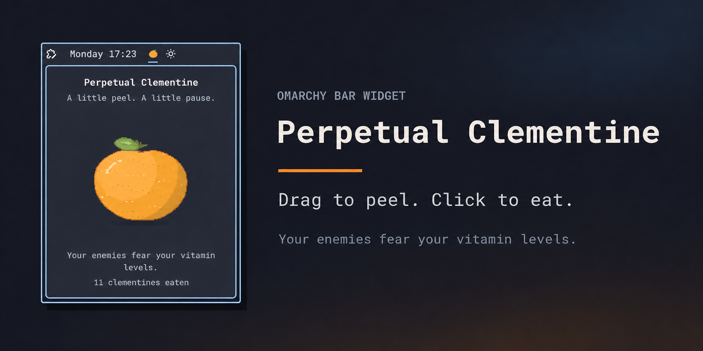
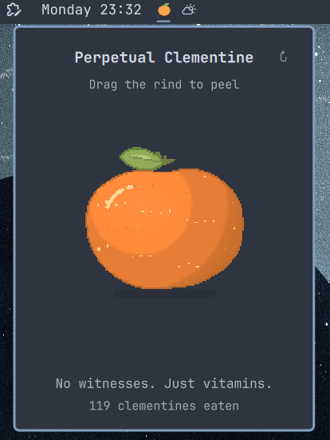

# Perpetual Clementine

Peel and eat a little pixel-art clementine from your Omarchy bar. Where you
start determines the peel pattern, and the seams vary a little with each
fruit. The plugin keeps a running total of the clementines you finish.



## Demo

| Peeling and eating | Popup |
| --- | --- |
|  |  |

| Colour bar icon | Monochrome bar icon |
| --- | --- |
|  |  |

## Install

Requires Omarchy's Quickshell-based shell. Tested with Omarchy 4.5.0.

```sh
omarchy plugin add https://github.com/droggokid/perpetual_clementine.git --yes --enable
```

## How to play

Click the orange in the bar and drag the rind to peel it. Once the fruit is
fully peeled, click a segment to eat it or hold and sweep across several, then
release. A new clementine appears after the last bite.

Use the arrow keys to select a spot or segment, then press Space or Enter to
peel or eat. Press R or click the reset button for a fresh fruit. Escape
cancels the current gesture or closes the popup. Right-click the bar icon to
switch between colour and monochrome on all monitors. The choice is saved
across shell restarts.

## Remove

```sh
omarchy plugin remove droggokid.perpetual-clementine
```

Your clementine total and icon style carry over if you reinstall.

## Contributing

See the [contribution guide](CONTRIBUTING.md).
